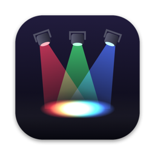
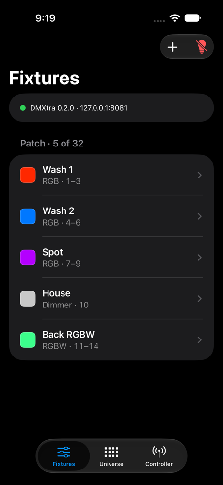
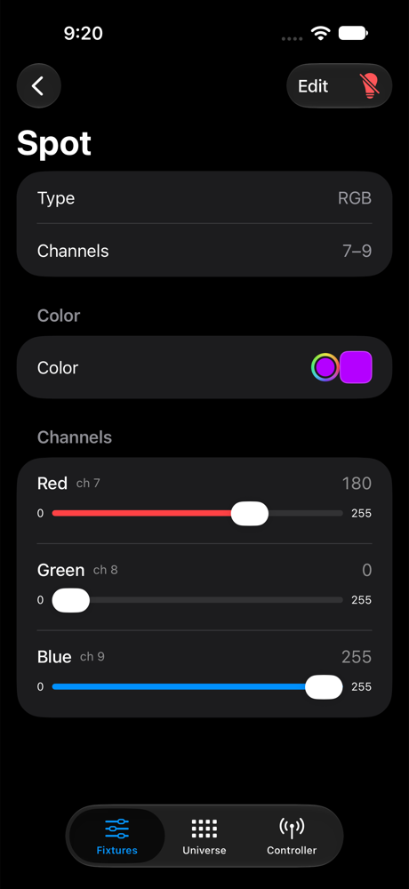
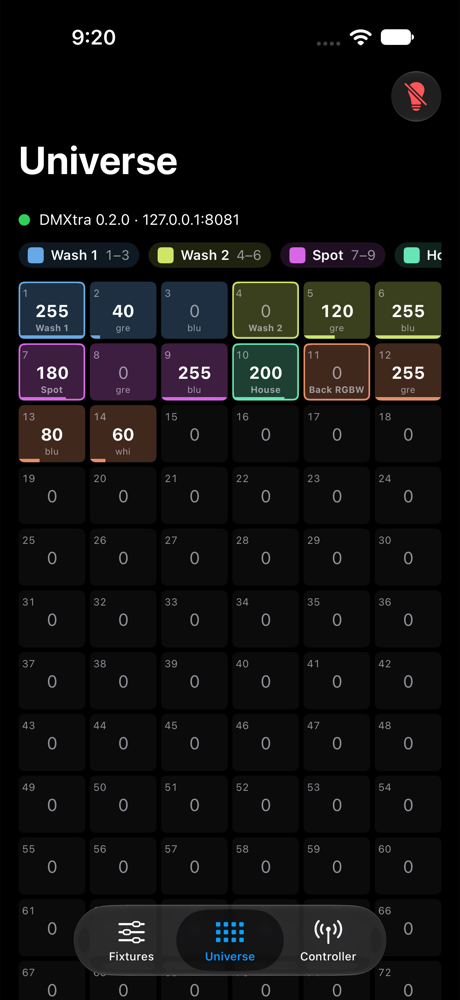
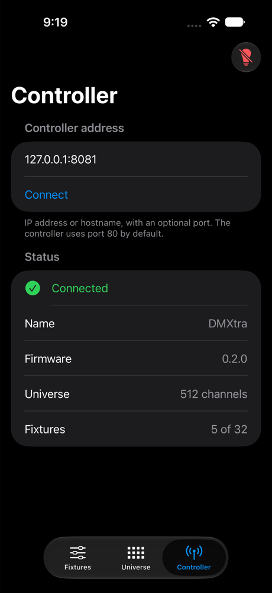
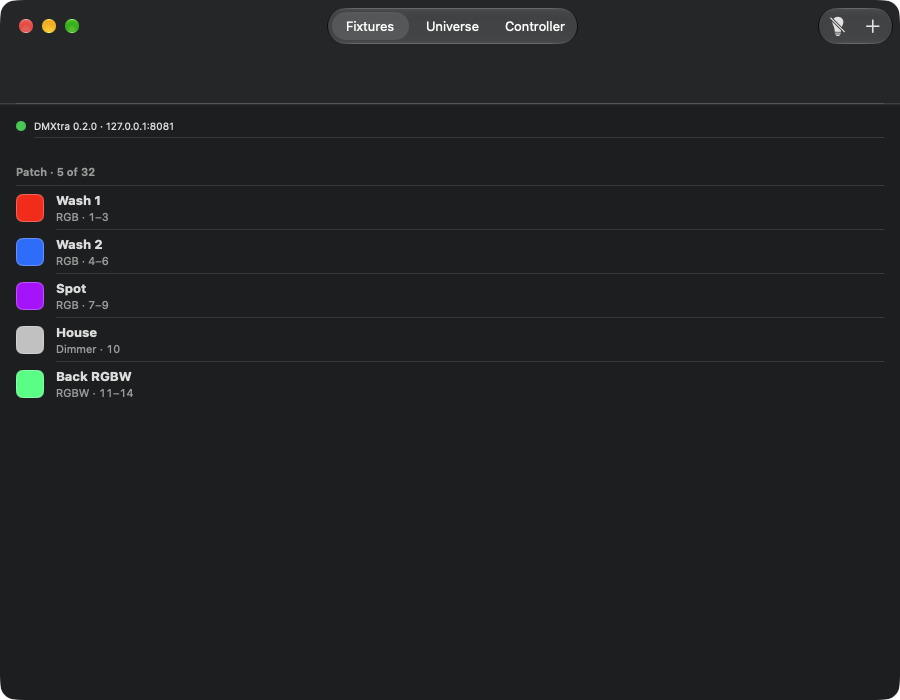
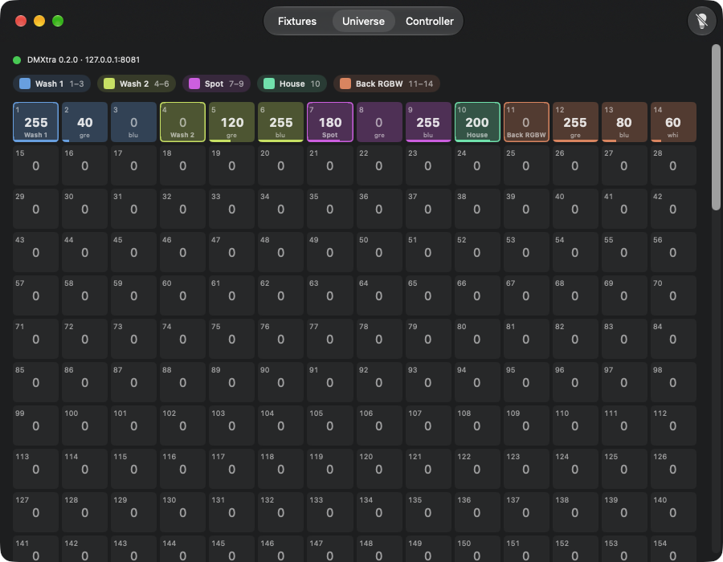
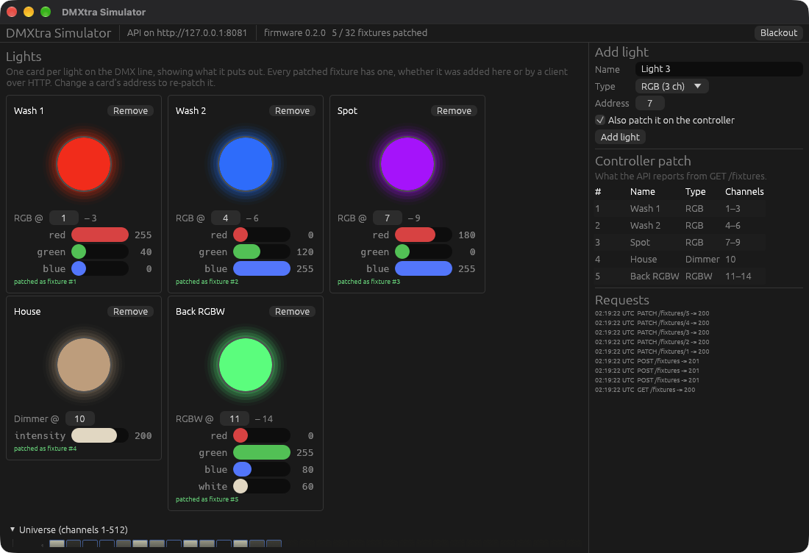

# DMXtra



DMXtra is a WiFi DMX lighting controller built for ESE 1110. An Arduino UNO R4 WiFi holds a
512-channel DMX universe and a patch of fixtures, and serves them over a small JSON HTTP API. A
SwiftUI app for iPhone, iPad and Mac controls it, and a Rust desktop simulator stands in for the
board so you can work on the app without any hardware.

| Part | Folder | What it is |
|---|---|---|
| Controller firmware | [`embedded/`](embedded) | PlatformIO project for the UNO R4 WiFi. API reference: [`embedded/API.md`](embedded/API.md) |
| DMXtra app | [`app/`](app) | SwiftUI app for iOS 17+ and macOS 14+ ([README](app/README.md)) |
| Simulator | [`simulator/`](simulator) | Rust desktop stand-in for the board, with a view of every light ([README](simulator/README.md)) |

## Screenshots

### iPhone

| Fixtures | Fixture control | Universe | Controller |
|:---:|:---:|:---:|:---:|
|  |  |  |  |

### Mac

| Fixtures | Universe |
|:---:|:---:|
|  |  |

### Simulator



All screenshots are of the app connected to the simulator, with five fixtures patched.

## Features

### Controller (firmware)

- Runs on an **Arduino UNO R4 WiFi** and joins your WiFi network. It prints its IP address on the
  serial monitor at startup.
- Holds a **512-channel DMX universe** (values 0–255). The universe is the only place values are
  stored. Fixtures are named views onto it.
- Keeps a **patch of up to 32 fixtures**, each with a name, a type and a start address. Fixtures
  can't overlap.
- **Fixture types** come from the controller (`GET /fixture-types`): Dimmer (1 channel), RGB (3) and
  RGBW (4). Clients don't hard-code them.
- **JSON HTTP API** on port 80: read and patch fixtures (`/fixtures`), read and write raw channels
  (`/dmx`), and `/blackout`. Errors come back as `{"error": "..."}` with clear status codes (400,
  404, 405, 409 overlap, 413 body too large, 507 patch full). Full reference:
  [`embedded/API.md`](embedded/API.md).
- **Two RGB test LEDs** on PWM pins act as DMX receivers with fixed addresses (channels 1–3 and
  4–6), like DIP switches on real fixtures.
- Boots with a default patch: "Wash 1" at address 1 and "Wash 2" at address 4. The patch resets on
  reboot.

### App (iOS, iPadOS and macOS)

- **Fixtures**: the patch at a glance, with each fixture's current color, type and channels.
  Add a fixture (with a "next free address" suggestion), or swipe to delete one.
- **Fixture control**: a color picker for RGB and RGBW fixtures, plus a fader for every channel.
  Fixture types the app has never seen still work: they get one labelled fader per channel.
- **Edit fixtures**: rename, re-address or delete a fixture. Overlaps and other errors show the
  controller's own message.
- **Universe**: all 512 channels in a grid, colored by fixture, with a legend. Tap a channel to set
  its value directly.
- **Blackout** button on every screen.
- **Controller**: enter the board's address (IP or hostname, optional port). It's saved and
  reconnected on launch. Shows the controller's name, firmware version, universe size and fixture
  count.
- **Live updates**: the app polls the controller every 2 seconds, so changes from other phones or
  the simulator show up, without overwriting a control you're still dragging.
- **Smooth faders**: changes are rate-limited to about 20 updates a second per fixture, and the
  final value is always sent when you let go. Requests go one at a time, because the board handles
  one connection at a time.
- One SwiftUI target for iPhone, iPad and Mac, with its own app icon.

### Simulator

- Serves the **same HTTP API as the firmware**, with the same status codes, error messages and
  validation rules, so the app can't tell it apart from the board.
- Shows **one card per light**: its output color, start address and channel values. Every patched
  fixture has a card, whether it was added from the simulator or by the app over HTTP, and all
  cards work the same way: change the address to re-patch, or **Remove** to unpatch.
- **Add light** form, the **controller patch** as clients see it, a **universe** grid of all 512
  channels, a **request log** and a **Blackout** button.
- Options for the interface (`--host 0.0.0.0` to reach it from a phone), the port, and extra
  latency per request (`--latency`) to feel more like the board.

## Getting started

### 1. Run the simulator (no hardware needed)

Needs a Rust toolchain ([rustup.rs](https://rustup.rs)).

```bash
cd simulator && cargo run --release
```

The API is now at `http://127.0.0.1:8080`. To reach it from a phone on the same WiFi, bind every
interface instead and use your Mac's IP address in the app:

```bash
cd simulator && cargo run --release -- --host 0.0.0.0 --port 8080
```

```bash
ipconfig getifaddr en0
```

### 2. Run the app

Needs Xcode and [XcodeGen](https://github.com/yonaskolb/XcodeGen) (`brew install xcodegen`). The
Xcode project is generated from `app/project.yml` and isn't committed.

```bash
cd app && xcodegen generate && open DMXtra.xcodeproj
```

Pick the **DMXtra** scheme and **My Mac** or an iPhone simulator, then press ⌘R. In the app's
**Controller** tab, enter `127.0.0.1:8080` and tap **Connect**. To run on a real iPhone, choose your
team under *Signing & Capabilities* and allow the Local Network prompt on first launch. See
[`app/README.md`](app/README.md) for command-line builds and more detail.

### 3. Run the board

Needs [PlatformIO](https://platformio.org) (the VS Code extension or the CLI).

1. Copy `embedded/include/secrets.example.h` to `embedded/include/secrets.h` and fill in your WiFi
   name and password. `secrets.h` is gitignored.
2. Build, upload and open the serial monitor:

   ```bash
   cd embedded && pio run -t upload && pio device monitor
   ```

3. Note the IP address it prints, and enter it in the app's **Controller** tab. Port 80 is the
   default, so no port is needed. Your phone or Mac must be on the same network as the board.

## Tests

App unit tests (model decoding, rate limiting, next-free-address maths):

```bash
cd app && xcodebuild -project DMXtra.xcodeproj -scheme DMXtra -destination 'platform=macOS' test
```

Add the integration tests by running them against a live simulator (or board). They change its
state and end with a blackout:

```bash
cd app && TEST_RUNNER_DMXTRA_MOCK_URL=127.0.0.1:8080 xcodebuild -project DMXtra.xcodeproj -scheme DMXtra -destination 'platform=macOS' test
```

Simulator tests (how the light cards and the API stay in step):

```bash
cd simulator && cargo test
```
