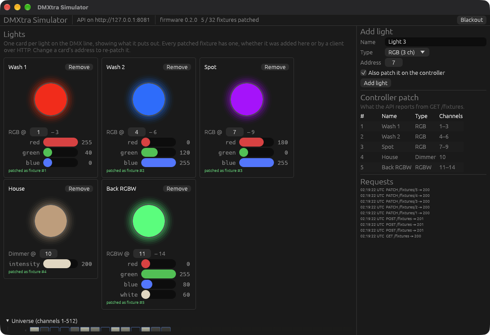

# DMXtra simulator

A desktop stand-in for the DMXtra board. It serves the same HTTP API as the firmware in
[`../embedded`](../embedded) (documented in [`../embedded/API.md`](../embedded/API.md)), with the
same status codes, error messages and validation rules, and opens an egui window showing what each
light is putting out.

## Run it

Needs a Rust toolchain ([rustup.rs](https://rustup.rs)).

```bash
cd simulator && cargo run --release
```

The API is then at `http://127.0.0.1:8080`. In the DMXtra app, enter `127.0.0.1:8080` on the
**Controller** tab.

To reach it from a phone on the same WiFi, bind every interface and use your computer's IP address:

```bash
cargo run --release -- --host 0.0.0.0 --port 8080
```

Options:

| Flag | Default | Meaning |
|---|---|---|
| `--host` | `127.0.0.1` | Interface to bind |
| `--port` | `8080` | TCP port |
| `--latency` | `0` | Extra delay per request, in ms, to feel more like the board |

## Lights and fixtures

The simulator keeps two ideas, like the firmware:

- **Fixtures** are the controller's patch: what `GET /fixtures` returns and what clients edit.
- **Lights** are the simulated hardware on the DMX line. Each one reads its channels from the
  universe at its start address and shows what it would put out.

Every fixture has its own light, however it was added: at startup, from the window, or by a client
over HTTP. A fixture's light follows it when its address changes and goes away when it is deleted,
so each card in the window behaves the same whichever way it was created. Lights added in the
window with **Also patch it on the controller** unticked are the exception: they have no fixture,
keep the address you give them, and don't appear in `GET /fixtures`.

This differs from the board, where the two test LEDs are wired to fixed addresses (1–3 and 4–6) and
stay there even if their fixtures move.

It starts in the same state as the board: fixtures "Wash 1" (address 1) and "Wash 2" (address 4),
each with an RGB light.

## The window



- **Lights**: one card per light, showing its output color, channel values and start address.
  Change the address (drag or type) to re-patch the fixture, the same as `PATCH /fixtures/{id}`
  with a new address; an address that would overlap another fixture is refused. **Remove** takes
  the light away and unpatches its fixture, the same as `DELETE /fixtures/{id}`.
- **Add light**: name, type and address. Leave **Also patch it on the controller** ticked to patch
  it as a fixture too, the same as `POST /fixtures`, so clients see it.
- **Controller patch**: the fixtures as the API reports them.
- **Universe**: all 512 channels; patched channels are outlined in blue. Hover a cell for its value.
- **Requests**: a log of recent API calls and their status codes.
- **Blackout** sets every channel to 0, same as `POST /blackout`.

State is held in memory and resets when you quit, just as the board resets on reboot.

## Code

- `src/state.rs`: universe, patch and lights, and the link between each fixture and its light.
- `src/api.rs`: the HTTP server and a port of the firmware's router and handlers. Requests are
  handled one at a time, like the board.
- `src/ui.rs`: the egui window. `cargo test` runs its tests of how cards and the API stay in step.
